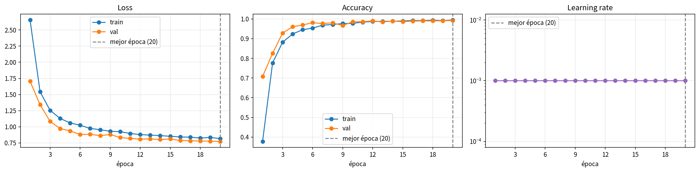
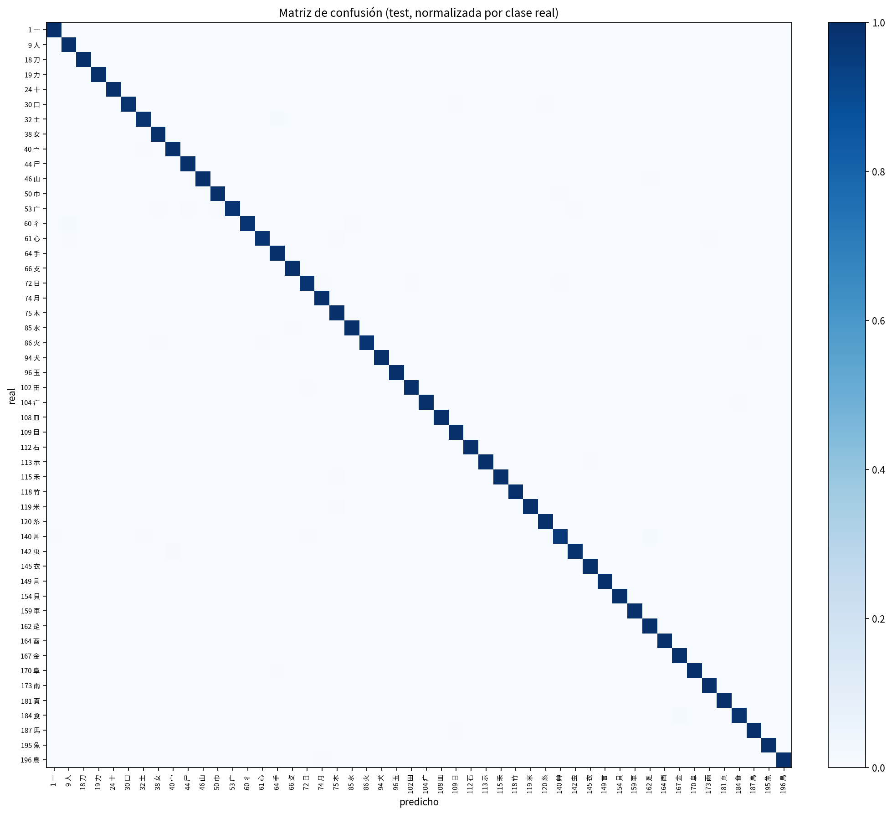
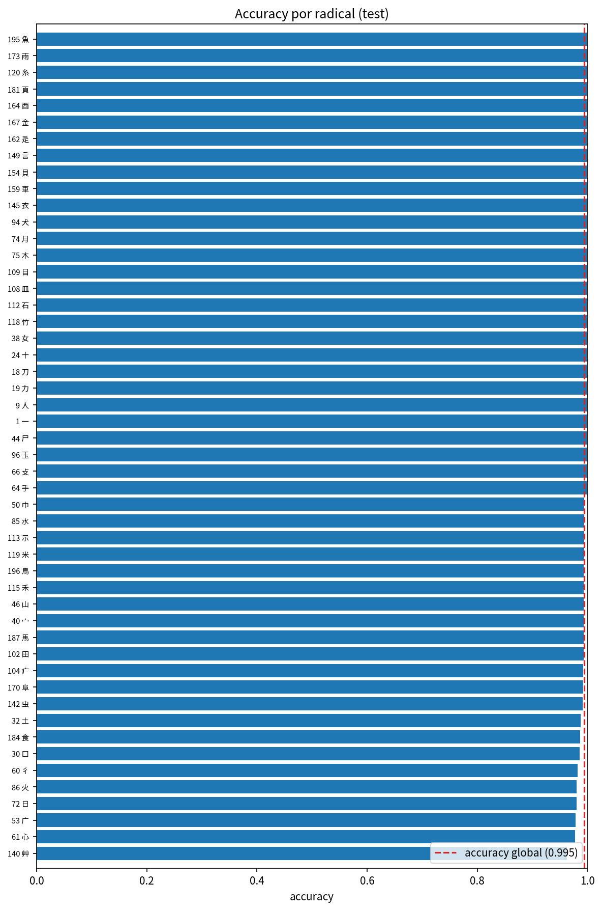
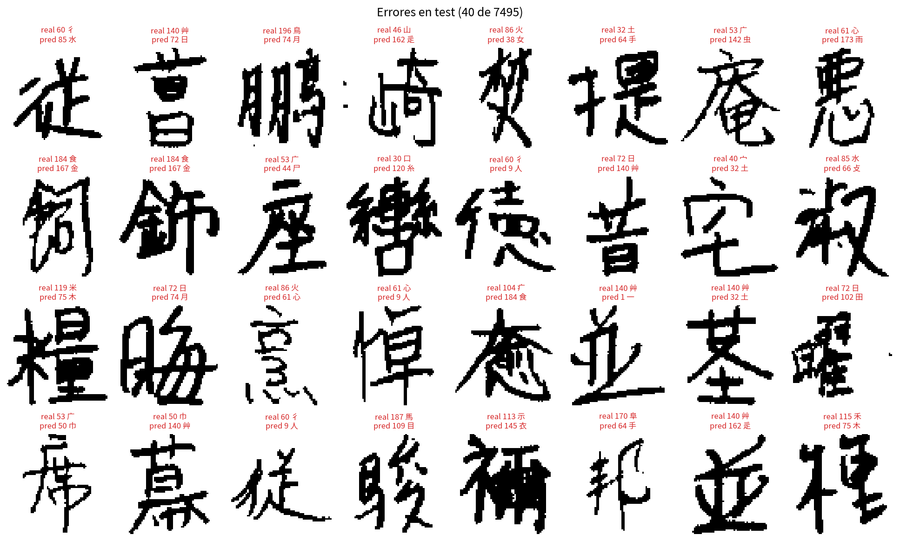
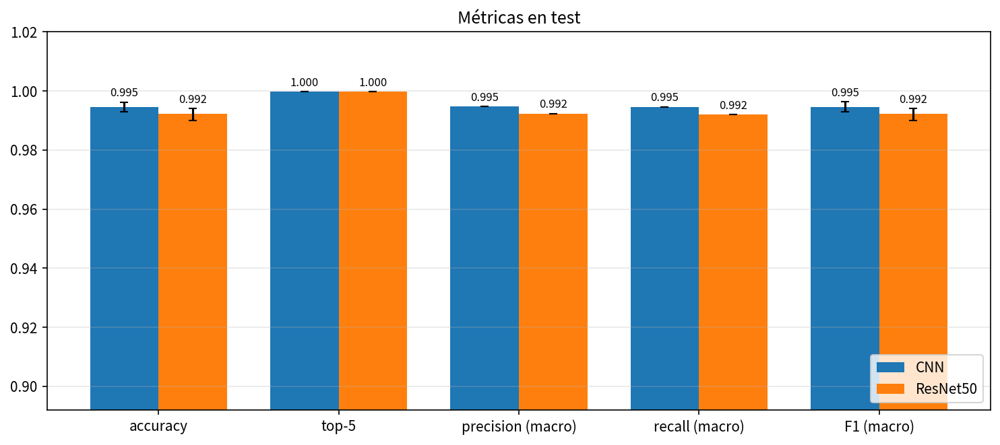
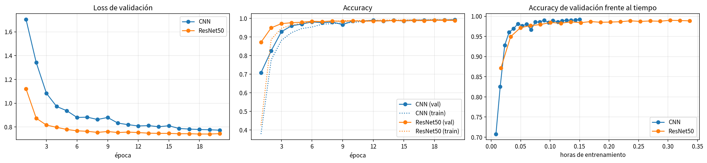
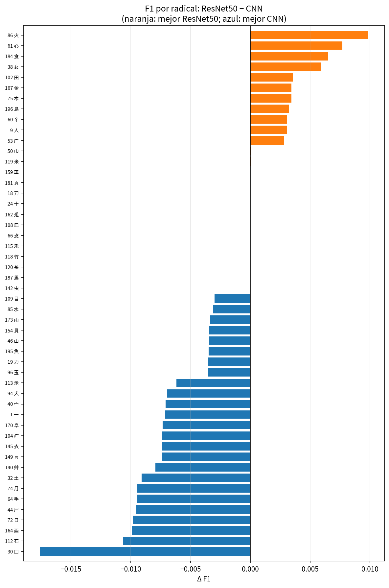
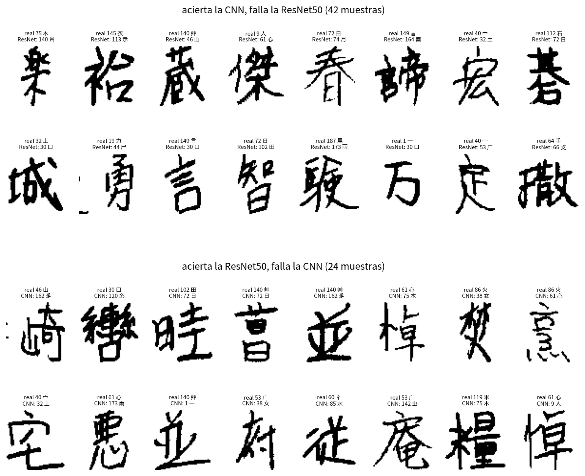

# kanji-cnn: clasificación del radical de kanji manuscritos

Red convolucional que, a partir de la imagen de un kanji escrito a mano, predice su **radical visual** (componente gráfico según la clasificación Kangxi de 214 radicales). Se entrena sobre la base de datos de caracteres manuscritos japoneses **ETL9B** y se compara con una **ResNet50 preentrenada en ImageNet** (ver [Comparación con ResNet50](#comparación-con-resnet50)).

## Flujo del proyecto

```
data/ETL9B/ETL9B_{1..5}            (imágenes binarias 64×63 + código JIS)
        │  preprocess/build_dataset.py
        ▼
data/build/sample_index.npy        (archivo, offset, escritor, clase de cada muestra)
data/build/class_labels.json       (clase → radical Kangxi y su glifo)
        │  training/train_model.py   (split por escritor 70/15/15)
        ▼
data/runs/<fecha-hora>-<modelo>/   (modelo, historial, métricas de test, figuras)
        │  compare.py                (kanji-compare: CNN vs ResNet50)
        ▼
data/runs/compare/                 (tabla, test de McNemar, figuras comparativas)
```

Todo el flujo se ejecuta con un solo comando: `uv run kanji-cnn` (ver [Uso](#uso)).

### 1. Construcción del dataset (`src/kanji_cnn/preprocess/`)

1. **Lectura de ETL9B** (`etl9b.py`): cada registro ocupa 576 bytes (id del escritor, código JIS y una imagen de 1 bit de 64×63). El índice solo guarda la posición de cada registro; las imágenes se leen bajo demanda.
2. **Filtro**: se descarta el hiragana. De los 3036 caracteres (610 236 registros) quedan 2965 kanji.
3. **Etiquetado por radical** (`dict_builder.py`, `radicals.py`): se descarga la descomposición IDS del proyecto [cjkvi-ids](https://github.com/cjkvi/cjkvi-ids) (se cachea en `data/build/ids/ids.txt`), preferentemente su variante japonesa. Un kanji recibe una etiqueta si exactamente uno de sus componentes de primer nivel es un radical Kangxi o una de sus variantes (氵→水, 亻→人…). Los kanji ambiguos o sin coincidencia se excluyen, y quedan 2159 kanji etiquetados.
4. **Balanceo** (`build_dataset.py`): se agrupan las muestras por radical, se exigen ≥500 muestras por clase y se conservan las **50 clases** más numerosas, con un muestreo de **1000 muestras por clase**. Resultado: 50 000 muestras.

### 2. División train / val / test por escritor

Los 4000 escritores de ETL9B escribieron muchos caracteres cada uno. Si se divide por muestra, la red se evalúa con la letra de personas que ya vio al entrenar y la métrica sale optimista. Por eso el split (`make_splits` en `training/train_model.py`) usa `StratifiedGroupKFold` agrupando por `writer_id`:

| Conjunto | Muestras | Escritores | Uso |
|---|---|---|---|
| train | ~35 000 (70 %) | ~2800 | ajuste de pesos (con augmentación) |
| val | ~7 500 (15 %) | ~600 | `ReduceLROnPlateau` y elección de la mejor época |
| test | ~7 500 (15 %) | ~600 | métricas finales; no interviene en ninguna decisión |

Ningún escritor aparece en dos conjuntos y las 50 clases quedan balanceadas en cada uno. El split es determinista para una `--seed` dada (por defecto 42).

### 3. Modelo (`src/kanji_cnn/cnn/radical_cnn.py`)

`KanjiRadicalCNN` tiene 4 bloques `[Conv3×3 → BN → ReLU] ×2 → MaxPool` (32→64→128→256 canales), seguidos de *global average pooling* y de un MLP `256 → 256 → n_clases` con Dropout 0.4. La entrada es la imagen binaria de 1 canal, de 63×64.

### 4. Entrenamiento y evaluación

- **Entrenamiento**: Adam (lr 1e-3), cross-entropy con *label smoothing* 0.1 y `ReduceLROnPlateau` sobre `val_loss` (factor 0.5, paciencia 3). La augmentación es `RandomAffine` (±8°, traslación ±8 %, escala 0.9–1.1), solo en train.
- **Mejor época**: se conservan los pesos de la época con menor `val_loss`, no los de la última.
- **Métricas de test**: accuracy, top-5, precision/recall/F1 macro, reporte por clase y matriz de confusión. También se miden parámetros, tamaño, segundos por época y milisegundos de inferencia por imagen.

## Requisitos e instalación

- Python ≥ 3.14 y [uv](https://docs.astral.sh/uv/).
- El dataset **ETL9B**. No se distribuye con el repositorio: se solicita en la [ETL Character Database](http://etlcdb.db.aist.go.jp/) (AIST) y los archivos `ETL9B_1` … `ETL9B_5` se colocan en `data/ETL9B/`.
- La primera vez que se entrena la ResNet50 se descargan sus pesos de ImageNet (~100 MB, caché en `~/.cache/torch`).
- Para ver los glifos de los radicales en las gráficas hace falta la fuente **Noto Sans CJK JP**. Sin ella, las etiquetas muestran solo el número de radical Kangxi.

```bash
uv sync
```

## Uso

Todos los comandos se ejecutan **desde la raíz del repositorio**, porque las rutas `data/...` son relativas al directorio actual.

```bash
uv run kanji-cnn                         # flujo completo: dataset → entrenar la CNN (20 épocas) → evaluar en test
uv run kanji-cnn --model resnet50        # lo mismo con la ResNet50 preentrenada (lr 1e-4)
uv run kanji-cnn --prepare-only          # solo construye data/build/
uv run kanji-cnn --epochs 2              # prueba rápida
uv run kanji-cnn --run-dir data/runs/exp1 --seed 7
uv run kanji-cnn --eval-only data/runs/exp1/model.pt   # reevalúa un modelo en test sin entrenar
uv run kanji-cnn --show                  # además de guardar las figuras, las abre
```

| Opción | Descripción |
|---|---|
| `--rebuild` | Regenera `data/build/` aunque ya exista (si existe, por defecto se omite este paso) |
| `--prepare-only` | Solo prepara el dataset |
| `--model {cnn,resnet50}` | Arquitectura: `cnn` (`KanjiRadicalCNN`, por defecto) o `resnet50` (preentrenada en ImageNet) |
| `--epochs N` | Épocas de entrenamiento (por defecto 20) |
| `--lr LR` | Learning rate (por defecto 1e-3 para `cnn` y 1e-4 para `resnet50`) |
| `--device {cpu,cuda}` | Dispositivo (por defecto `cuda` si está disponible) |
| `--seed N` | Semilla del split train/val/test (por defecto 42) |
| `--run-dir DIR` | Carpeta de salida (por defecto `data/runs/<fecha-hora>-<modelo>`) |
| `--eval-only CKPT` | Evalúa un checkpoint en test; usa la semilla guardada en el checkpoint, así que el test es el mismo |
| `--show` | Muestra las figuras en pantalla |

## Salidas

Cada ejecución crea `data/runs/<fecha-hora>-<modelo>/` (o la carpeta de `--run-dir`) con:

| Archivo | Contenido |
|---|---|
| `model.pt` | Pesos de la mejor época, `model`, `class_labels`, `seed`, `best_epoch` y `lr` |
| `history.json` | Por época: `train_loss`, `train_acc`, `val_loss`, `val_acc`, `lr` y `epoch_time` (s). Se reescribe en cada época, así que si la ejecución se interrumpe no se pierde el historial |
| `metrics.json` | Test: `acc`, `top5`, `precision_macro`, `recall_macro`, `f1_macro`, reporte por clase, tamaños del split y coste (`n_params`, `size_mb`, `mean_epoch_time_s`, `inference_ms_per_img`) |
| `predictions.npz` | `y_true` e `y_pred` de test, para `kanji-compare` |
| `curves.png` | Curvas de loss y accuracy de train vs. val, con la mejor época marcada |
| `confusion_matrix.png` | Matriz de confusión de test, normalizada por clase real |
| `per_class_accuracy.png` | Accuracy por radical, ordenada de peor a mejor |
| `errors.png` | Ejemplos de test mal clasificados (radical real vs. predicho) |

Para cargar el modelo en otro script:

```python
import torch
from kanji_cnn.cnn.models import build_model

ckpt = torch.load("data/runs/exp1/model.pt", map_location="cpu")
model = build_model(ckpt.get("model", "cnn"), ckpt["n_classes"])
model.load_state_dict(ckpt["state_dict"])
model.eval()
# ckpt["class_labels"][i]["radical_glyph"] → glifo del radical de la clase i
```

## Resultados

Ejecución de referencia: notebook `CNN_Kanji_Colab.ipynb` en Google Colab, con GPU, 20 épocas por modelo y semilla 42. El test tiene **7495 imágenes de 603 escritores** que la red no vio al entrenar. Las figuras están en [`assets/`](assets/).

### CNN (`KanjiRadicalCNN`)

| Métrica (test) | Valor |
|---|---|
| accuracy | **0.9947** (IC 95 %: 0.993–0.996) |
| top-5 | 0.9999 |
| precision (macro) | 0.9947 |
| recall (macro) | 0.9947 |
| F1 (macro) | **0.9947** (IC 95 %: 0.993–0.996) |
| errores | 40 de 7495 |
| mejor época | 20 de 20 (val_acc 0.9923) |

La misma CNN entrenada en local (CPU, 20 épocas, `uv run kanji-cnn`) obtiene **0.9917** de accuracy y de F1 macro. Su split es algo distinto (ver la nota en [Notebooks](#notebooks)).



- **No hay sobreajuste.** En la mejor época, la brecha train−val es +0.002. La accuracy de test (0.9947) es incluso algo mayor que la de val (0.9923), así que elegir la época por `val_loss` no sobreajustó a val.
- **La CNN aún no había convergido.** `val_loss` sigue bajando en la época 20 y `ReduceLROnPlateau` nunca redujo el lr. Con más épocas probablemente mejoraría algo.
- Las `train_acc`/`train_loss` se miden con augmentación y dropout activos. Por eso quedan por debajo de las de validación en las primeras épocas.



La matriz es casi diagonal. Los radicales con menor recall son 艸 (0.963), 心 (0.977), 广 (0.979), 日 (0.980) y 火 (0.981):



Los 40 errores restantes son de tres tipos:

1. **Escritura muy cursiva o comprimida**: trazos fusionados o componentes deformados.
2. **Componentes que parecen otro radical**: la parte superior de un kanji que recuerda a 艹 o a 日, o un 彳 que se lee como 亻 o 氵.
3. **Etiquetas discutibles.** Algunos fallos no son del modelo, sino de la regla de etiquetado. Por ejemplo, 並 (IDS `⿱䒑业`) se etiqueta como 艸 porque 䒑 cuenta como variante de 艸. Visualmente no es la hierba, y en el diccionario Kangxi su radical es 一, que es justo lo que predice la CNN en varios de estos "errores". Por eso 艸 es la clase con menor recall.



## Comparación con ResNet50

¿Merece la pena una arquitectura estándar, mucho más grande y preentrenada, frente a una CNN diseñada para el problema? Se compara `KanjiRadicalCNN` con una **ResNet50 preentrenada en ImageNet** (*fine-tuning* completo) sobre el mismo test.

### Cómo se adapta ResNet50 (`src/kanji_cnn/cnn/resnet.py`)

1. **`conv1` de 3 canales a 1.** El filtro nuevo es la suma de los tres filtros RGB preentrenados. Sobre una imagen gris replicada en 3 canales da exactamente la misma respuesta, así que se conserva lo aprendido en ImageNet.
2. **Normalización** con la media y la desviación del gris de ImageNet (0.449 y 0.226), dentro del modelo. Así el pipeline de datos es idéntico para los dos modelos.
3. **Capa final** `fc` de 2048 → 50 clases.

La entrada se mantiene en 63×64. Reescalar a 128×128 o quitar el *stride* inicial multiplicaba el tiempo por época en CPU por ~3,5 y por más de 10, respectivamente.

### Qué se mantiene igual

El split por escritor (semilla 42), las 50 clases, la entrada 1×63×64 y la augmentación (solo en train) son los mismos. También la pérdida (CE + *label smoothing* 0.1), Adam con `ReduceLROnPlateau`, las 20 épocas y la elección de la mejor época por `val_loss`. **La única diferencia es el learning rate**: 1e-3 para la CNN, que parte de cero, y 1e-4 para la ResNet50, el valor habitual en *fine-tuning*. Con 1e-3, las primeras actualizaciones destruirían los pesos preentrenados.

### Cómo reproducirla

```bash
uv run kanji-cnn --model cnn      --run-dir data/runs/cnn
uv run kanji-cnn --model resnet50 --run-dir data/runs/resnet50
uv run kanji-compare data/runs/cnn data/runs/resnet50 --out data/runs/compare
```

`kanji-compare` comprueba que las dos corridas usan el mismo test (misma semilla y mismas etiquetas, en el mismo orden). Después escribe `comparison.json`, `comparison.md` y cuatro figuras: métricas con IC, curvas comparadas, diferencia de F1 por radical y ejemplos en los que discrepan. En los notebooks es la sección 12.

### Resultados

| Métrica (test, n = 7495) | CNN | ResNet50 | Δ (ResNet − CNN) |
|---|---|---|---|
| accuracy | **0.9947** [0.993, 0.996] | 0.9923 [0.990, 0.994] | −0.0024 |
| top-5 | 0.9999 | 0.9999 | 0 |
| precision (macro) | **0.9947** | 0.9924 | −0.0023 |
| recall (macro) | **0.9947** | 0.9920 | −0.0026 |
| F1 (macro) | **0.9947** [0.993, 0.996] | 0.9922 [0.990, 0.994] | −0.0025 |
| loss de test | 0.7667 | **0.7284** | −0.0383 |
| errores | **40** | 58 | +18 |

Entre corchetes, el intervalo de confianza del 95 % (*bootstrap*, 1000 remuestreos).



**Test de McNemar.** Ambos aciertan 7413 imágenes y ambos fallan 16. De las 66 en las que discrepan, **42 las acierta solo la CNN y 24 solo la ResNet50** (p = 0.036).

La diferencia es **significativa (p < 0.05), aunque pequeña**: 0.24 puntos de accuracy, 18 imágenes netas. Los intervalos de confianza se solapan porque cada uno mide la incertidumbre de un modelo por separado. McNemar compara los dos modelos imagen por imagen, y por eso detecta la diferencia.

| Coste | CNN | ResNet50 | ResNet / CNN |
|---|---|---|---|
| parámetros | **1 251 282** | 23 604 210 | ×18.9 |
| tamaño (float32) | **4.8 MB** | 90.2 MB | ×18.9 |
| s / época, GPU (train + val) | **27** | 61 | ×2.2 |
| s / época, CPU de 12 hilos | **276** | ~630 | ×2.3 |
| ms / imagen, inferencia en GPU | **0.13** | 0.45 | ×3.4 |
| mejor época | 20 | 18 | |
| brecha train − val acc (mejor época) | +0.002 | +0.004 | |

### ¿Por qué gana la CNN?



1. **El preentrenamiento acelera el comienzo, pero no decide el final.** Con los pesos de ImageNet, la ResNet50 alcanza 0.872 de val_acc en la primera época (la CNN, 0.708) y 0.949 en la segunda. Los detectores de bordes y formas aprendidos en fotografías sí sirven para trazos. Pero desde la época 6 los dos modelos superan 0.98, y en las últimas épocas la CNN va casi siempre por delante (época 20: 0.9923 frente a 0.9886). La ResNet50 se estanca en torno a 0.988–0.990 (mejor época: 18), mientras que la CNN sigue mejorando hasta la 20 sin que se reduzca su lr.
2. **La resolución.** El *stem* de ResNet50 (conv 7×7 con *stride* 2 + *maxpool*) reduce la imagen de 63×64 a **16×16 en sus dos primeras operaciones**, y la red termina en un mapa de 2×2. La CNN aplica dos convoluciones 3×3 a resolución completa antes de reducir. Los trazos de un kanji miden 1–3 píxeles, y la ResNet50 los resume demasiado pronto. Los datos lo confirman:
   - Los radicales en los que más gana la CNN se distinguen por **detalles internos pequeños**: 口, 石, 酉, 日, 尸, 月 y 土.
   - Entre los errores exclusivos de la ResNet50 abundan las confusiones entre **cajas cerradas que difieren en uno o dos trazos**: 日→月, 日→田, 石→日, 言→口, 一→口.
   - La ResNet50 gana en radicales de trazos curvos, sueltos o grandes (火, 心, 食, 女), y siempre por menos de 0.01 de F1.

   

   

   En total, la CNN es mejor en 28 radicales, la ResNet50 en 13, y empatan en 9.
3. **Un modelo a la medida del problema basta.** Son 50 clases de imágenes binarias sin color ni textura, con 35 000 imágenes de entrenamiento. Para esto, 1.25 M parámetros son suficientes y ninguno de los dos modelos sobreajusta. Los 23.6 M parámetros de la ResNet50, y lo que aprendió sobre color y textura en ImageNet, no aportan capacidad útil.
4. **Menor loss no es mayor accuracy.** La ResNet50 tiene menor loss en validación y en test (0.728 frente a 0.767), es decir, está más segura de sus aciertos. Pero la clase final se decide por el argmax, y con ese criterio la CNN se equivoca menos.
5. **El coste.** La CNN entrena 2.2 veces más rápido por época en GPU, infiere 3.4 veces más rápido y ocupa 19 veces menos. En la gráfica de accuracy frente al tiempo, la CNN termina sus 20 épocas en 9 minutos, cuando la ResNet50 aún no ha completado la mitad.

**Conclusión.** La CNN diseñada para el problema es la mejor opción: algo más precisa (diferencia significativa, pero pequeña) y mucho más barata de entrenar, desplegar y ejecutar. La ResNet50 preentrenada solo compensa si se necesita un modelo aceptable con muy pocas épocas: tras 1–2 épocas va claramente por delante.

**Limitaciones.**
- Hay una sola semilla.
- No se ajustó el lr de ninguno de los dos modelos.
- La ResNet50 trabaja a 63×64, lejos de los 224×224 para los que se diseñó. Con más resolución, o sin el *stride* inicial, podría recortar la diferencia, a un coste varias veces mayor.
- Con más épocas, la CNN, que no había convergido, probablemente ampliaría la ventaja.

## Rendimiento

| | CNN | ResNet50 |
|---|---|---|
| CPU, 12 hilos (por época / 20 épocas) | ~5 min / ~1,5 h | ~10,5 min / ~3,5 h |
| GPU de Google Colab (por época / 20 épocas) | ~27 s / ~9 min | ~61 s / ~20 min |

Con GPU, usa `--device cuda`, que es el valor por defecto si está disponible, o el notebook de Colab.

## Notebooks

Todo el proyecto (dataset, entrenamiento, evaluación y comparación con ResNet50) está también en un notebook autocontenido que no importa el paquete. Hay dos versiones con el mismo contenido:

- **`src/kanji_cnn/notebook/CNN_Kanji.ipynb`**, para ejecutarlo en local. ETL9B va en `notebook/dataset/` y los resultados se guardan en `notebook/artifacts/`.
- **`src/kanji_cnn/notebook/CNN_Kanji_Colab.ipynb`**, para [Google Colab](https://colab.research.google.com/github/therake77/pc2grafica/blob/main/src/kanji_cnn/notebook/CNN_Kanji_Colab.ipynb) con GPU. Monta Google Drive y usa `/content/drive/MyDrive/UNI/computacion-grafica/pc2/data` como `data/`:
  - Sube ETL9B a `data/ETL9B/`. Al empezar, el notebook lo copia al disco local de la sesión, porque leerlo desde Drive registro a registro es muy lento.
  - Lo que genera se guarda con la misma estructura que `data/` en el proyecto: `build/`, `runs/cnn/`, `runs/resnet50/` y `runs/compare/`, con `model.pt`, `history.json`, `metrics.json`, `predictions.npz` y las figuras.
  - Esas carpetas se pueden copiar al repo (por ejemplo, a `data/colab/`) y usar con `kanji-compare`.
  - Tras cada época guarda un punto de control (`last.pt`). Si Colab corta la sesión, al volver a ejecutar todo, el entrenamiento se reanuda desde la última época completada.
  - **El split no coincide exactamente entre entornos.** Con la misma semilla, Colab dio un test de 7495 imágenes y el entorno local, de 7511. Los escritores por conjunto son los mismos en número (2798/599/603), pero las clases quedan menos equilibradas en Colab. La causa más probable es la diferencia de versiones de scikit-learn (`StratifiedGroupKFold`). Dentro de un mismo entorno, la CNN y la ResNet50 usan el mismo split, así que la comparación es válida. Lo que no conviene es mezclar modelos o métricas de entornos distintos, ni cargar en Colab un `model.pt` entrenado en local: su test podría incluir escritores que el modelo vio al entrenar.

## Estructura del repositorio

```
assets/                      # figuras de la ejecución de referencia (README)
src/kanji_cnn/
├── main.py                  # orquestación del flujo completo (CLI `kanji-cnn`)
├── compare.py               # comparación de dos corridas (CLI `kanji-compare`)
├── preprocess/
│   ├── etl9b.py             # lectura del formato binario ETL9B
│   ├── radicals.py          # los 214 radicales Kangxi y sus variantes
│   ├── dict_builder.py      # etiquetado kanji → radical vía IDS (cjkvi-ids)
│   ├── build_dataset.py     # filtrado, balanceo y escritura de data/build/
│   └── read_test.py         # visor rápido de registros ETL
├── dataset/etl_dataset.py   # Dataset de PyTorch sobre sample_index.npy
├── cnn/
│   ├── radical_cnn.py       # arquitectura KanjiRadicalCNN
│   ├── resnet.py            # ResNet50 de torchvision adaptada a 1 canal
│   └── models.py            # registro de modelos (--model) y lr por defecto
├── training/train_model.py  # split por escritor, bucle de entrenamiento y evaluación
├── evaluation/
│   ├── metrics.py           # accuracy, top-5, precision/recall/F1, IC bootstrap, matriz de confusión
│   ├── comparison.py        # McNemar, F1 por clase y tablas de la comparación
│   └── plots.py             # figuras con matplotlib
└── notebook/
    ├── CNN_Kanji.ipynb       # todo el proyecto, comparación incluida, en un notebook (local)
    └── CNN_Kanji_Colab.ipynb # lo mismo para Google Colab, con datos y resultados en Drive
```
