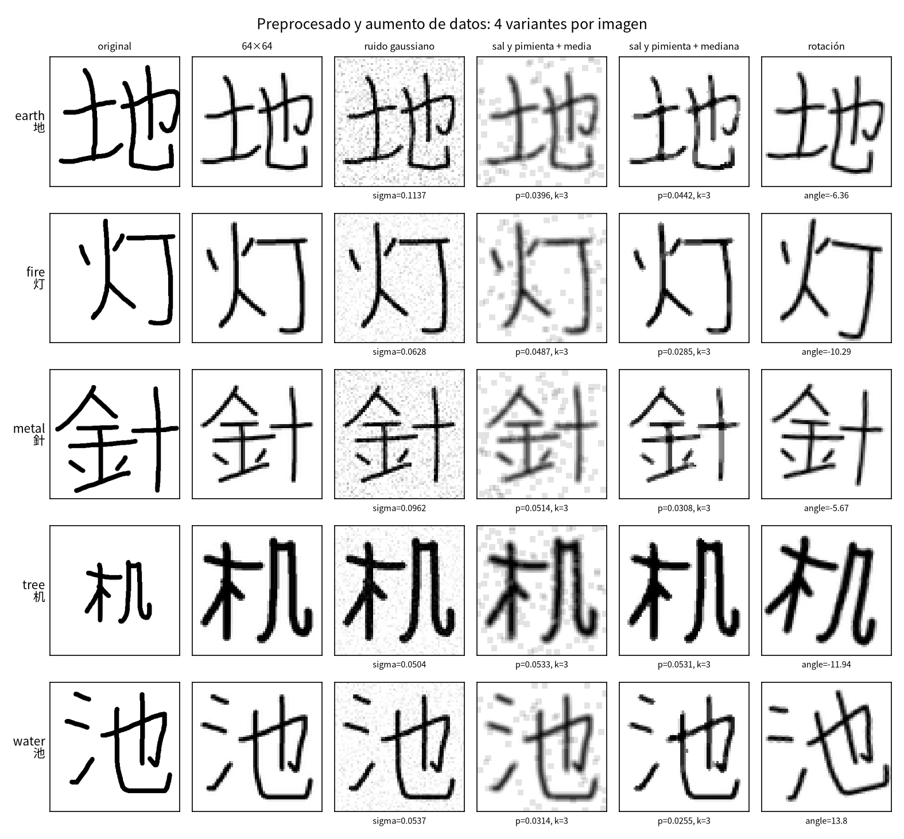
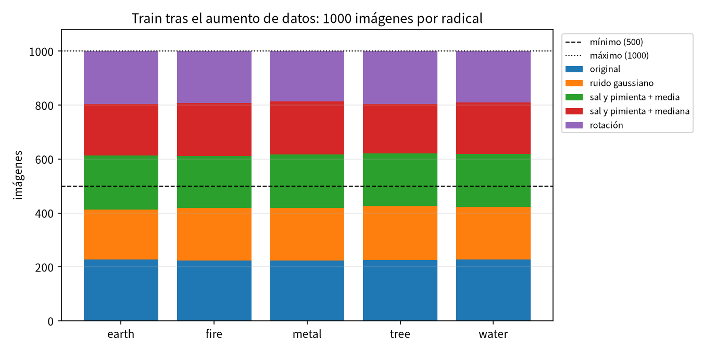

# kanji-cnn: clasificación del radical de kanji dibujados a mano

Red convolucional que, a partir de un kanji dibujado a mano, predice cuál de **5 radicales** contiene: 土 (`earth`), 火 (`fire`), 金 (`metal`), 木 (`tree`) u 氵 (`water`). Las imágenes las dibuja el equipo con una app propia (`make draw`). El modelo se compara con una **ResNet50 preentrenada en ImageNet** (ver [Resultados y comparación con ResNet50](#resultados-y-comparación-con-resnet50)).

Hay muchos más kanji (43) que clases: la red no tiene que reconocer el kanji, sino el radical que comparte con otros (池, 海 y 湖 son todos `water`).

> La versión anterior del proyecto entrenaba sobre la base de datos ETL9B (50 radicales). Ese código se retiró; sigue en el historial de git (commit `2e7841e`).

## Flujo del proyecto

```
make draw  →  drawings/<clase>/<kanji>/<escritor>-<NN>.png   (PNG 300×300, trazo en el canal alfa)
        │  dataset/drawings.py      (etiqueta = carpeta de clase; preprocesado a 64×64)
        ▼
data/build/drawings_index.csv      (ruta, etiqueta, kanji, escritor y split de cada dibujo)
data/build/class_labels.json       (clase → radical, nº de kanji y de dibujos)
        │  dataset/augment.py        (solo train: 4 transformaciones por imagen → 500–1000 por radical)
        ▼
data/build/train_augmented.csv     (cada imagen de train: dibujo de origen, transformación y parámetros)
        │  training/train_model.py   (entrenamiento; val y test son dibujos originales)
        ▼
data/runs/<corrida>/               (modelo, historial, métricas de test, figuras)
        │  compare.py                (kanji-compare: CNN vs ResNet50)
        ▼
data/runs/compare/                 (tabla, test de McNemar, figuras comparativas)
```

Todo el flujo se ejecuta con `make train` (o `uv run kanji-cnn`); ver [Uso](#uso).

### 1. Recolección de dibujos (`src/kanji_cnn/collect/`)

La app Flask (`make draw`, en http://127.0.0.1:5000) muestra a cada escritor el kanji que le toca, con el orden de trazos de referencia, y un lienzo de 300×300 con un pincel de 10 px. Cada escritor (jarem, amir, piero y diego) dibuja cada kanji **9 veces** (`water`, `tree`, `earth`) o **10** (`fire`, `metal`). Cada uno empieza por una clase distinta (`collect/kanji_list.py`). Los dibujos se guardan en:

```
drawings/<clase>/<kanji>/<escritor>-<NN>.png        p. ej. drawings/fire/畑/diego-03.png
```

| Clase | Radical | Kanji |
|---|---|---|
| `earth` | 土 | 地 坂 均 坊 城 型 域 場 坪 |
| `fire` | 火 | 灯 炉 炊 炒 畑 炎 炭 灰 |
| `metal` | 金 | 針 釣 鈴 鉄 鉛 銀 銅 銭 |
| `tree` | 木 | 机 村 材 林 板 松 校 桜 杉 |
| `water` | 氵 | 池 河 油 泳 波 海 洋 流 湖 |

El radical se elige por **apariencia**: 畑 está en `fire` porque lleva 火 a la izquierda, aunque el diccionario Kangxi lo clasifique bajo 田.

**Estado a 16/10/2026**: los cuatro escritores terminaron, **1612 dibujos** (403 por escritor; 320–324 por radical). El pipeline no asume ningún tamaño: vuelve a escanear `drawings/` en cada ejecución, así que los dibujos que se añadan o retoquen entran solos.

### 2. Etiquetado y preprocesado (`src/kanji_cnn/dataset/drawings.py`)

1. **Etiqueta = carpeta.** Las clases son las subcarpetas de `drawings/`, ordenadas alfabéticamente (`earth`=0, `fire`=1, `metal`=2, `tree`=3, `water`=4). Del nombre del archivo salen el escritor y el número de repetición, y de la carpeta intermedia, el kanji.
2. **Tinta.** El trazo solo vive en el canal alfa del PNG, así que ese canal ya es la imagen (tinta = 1, fondo = 0).
3. **Recorte y centrado.** Se recorta a la caja del kanji y se centra en un cuadrado con un 8 % de margen, sin deformarlo. Así no influye dónde ni a qué tamaño se dibujó en el lienzo, pero se conservan las posiciones relativas (el radical a la izquierda, abajo…).
4. **Reducción a 64×64** con antialias. El pincel de 10 px queda en unos 2 px.

Todas las imágenes se cargan en memoria al empezar (~26 MB con 1600 dibujos). El resultado de esta etapa es el **manifiesto** `data/build/drawings_index.csv`, con una fila por dibujo (`path, label, class_index, kanji, writer, number, split`), y la figura `data/build/figures/dataset_counts.png`.

### 3. División train / val / test

70 % train, 15 % val y 15 % test, **estratificado por kanji** (`make_splits` en `training/train_model.py`): cada kanji, y por tanto cada radical, aparece en los tres conjuntos en la misma proporción. Un kanji con menos de 3 dibujos (por ejemplo, uno recién empezado) se estratifica solo por su clase.

| Conjunto | Uso |
|---|---|
| train | ajuste de pesos, tras el aumento de datos (sección 4) |
| val | `ReduceLROnPlateau` y elección de la mejor época |
| test | métricas finales; no interviene en ninguna decisión |

Con los 1612 dibujos actuales: **1128 / 242 / 242**.

**Limitación: test es optimista.** Cada escritor dibuja cada kanji 9-10 veces seguidas, y esas repeticiones se reparten entre los tres conjuntos. Test mide, sobre todo, si la red reconoce otra repetición de un kanji que ya vio dibujado por la misma persona, no un kanji nuevo ni la letra de un escritor nuevo. Ahora que los cuatro escritores terminaron, el manifiesto (que guarda el escritor de cada dibujo) permite probar un split por escritor (uno de ellos entero en test), que mediría la generalización a letra nueva.

El split es determinista para unos mismos dibujos y una `--seed` (por defecto 42). Cada corrida guarda una **huella** del conjunto de archivos (sha1 de las rutas). Si llegan dibujos nuevos, la huella cambia: `--eval-only` y `kanji-compare` se niegan a mezclar corridas de conjuntos distintos, porque su test ya no sería el mismo.

### 4. Aumento de datos, solo en train (`src/kanji_cnn/dataset/augment.py`)

Train se aumenta hasta tener **entre 500 y 1000 imágenes por radical**. Cada dibujo de train genera **4 variantes**, una por transformación:

| Transformación | Qué hace | Parámetro aleatorio |
|---|---|---|
| ruido gaussiano | suma N(0, σ) a cada píxel | σ ∈ [0.05, 0.15] |
| sal y pimienta + media | una proporción p de píxeles pasa a 0 o a 1, y después un filtro de media 3×3: el ruido se difumina, pero no desaparece | p ∈ [0.02, 0.06] |
| sal y pimienta + mediana | el mismo ruido y después un filtro de mediana 3×3, que elimina casi todo el ruido impulsivo sin difuminar el trazo | p ∈ [0.02, 0.06] |
| rotación | gira el kanji alrededor del centro | ±3° a ±15° |

- Se aplican a la imagen **ya preprocesada** (64×64). Sobre el PNG de 300×300, el ruido repartido por el lienzo arruinaría el recorte a la caja del kanji. Los filtros son de 3×3 porque a 64×64 el trazo mide ~2 px y uno de 5×5 lo borraría.
- **Objetivo común T** = 5 × (originales de train de la clase más grande), acotado a [500, 1000]. Todas las clases terminan con T imágenes, así que quedan equilibradas.
- Si 4 variantes por imagen no alcanzan T, se hacen **más rondas** con parámetros nuevos. Si se pasan de T, se recorta la última ronda repartiendo las variantes por igual entre los originales.
- **Solo se aumenta train**, después del split. Val y test siguen siendo dibujos reales, y ninguna variante sale de un dibujo de val o de test.
- Las variantes se generan **en memoria** en cada ejecución, siempre las mismas para una misma `--seed`. No se escriben PNG. `data/build/train_augmented.csv` registra cada imagen de train: `source_path, label, class_index, kanji, writer, transform, round, params`.

Con los 1612 dibujos actuales, train tiene ~227 originales por radical. 5 × 227 = 1135 pasa del máximo, así que T = 1000: **5000 imágenes de train** (~225 originales y ~775 variantes por radical), y cada original queda con 3 o 4 variantes. Para respetar el máximo de 1000 no caben las 4 variantes de todos los dibujos.





### 5. Modelo (`src/kanji_cnn/cnn/radical_cnn.py`)

`KanjiRadicalCNN` tiene 4 bloques `[Conv3×3 → BN → ReLU] ×2 → MaxPool` (32→64→128→256 canales), seguidos de *global average pooling* y de un MLP `256 → 256 → 5` con Dropout 0.4. La entrada es la imagen de 1 canal de 64×64, que llega al pooling global como un mapa de 4×4. Tiene 1.24 M parámetros.

### 6. Entrenamiento y evaluación

- **Entrenamiento**: Adam (lr 1e-3), *batches* de 32, cross-entropy con *label smoothing* 0.1 y `ReduceLROnPlateau` sobre `val_loss` (factor 0.5, paciencia 3), **20 épocas**. Cada época recorre las 5000 imágenes del train aumentado. No se aplica ninguna otra augmentación aleatoria durante el entrenamiento: solo la de la sección 4.
- **Mejor época**: se conservan los pesos de la época con menor `val_loss`, no los de la última.
- **Métricas de test**: accuracy, precision/recall/F1 macro, reporte por clase, matriz de confusión y **accuracy por kanji**. Con 5 clases no tiene sentido el top-5, que siempre vale 1. También se miden parámetros, tamaño, segundos por época y milisegundos de inferencia por imagen.

## Requisitos e instalación

- Python ≥ 3.14 y [uv](https://docs.astral.sh/uv/).
- La primera vez que se entrena la ResNet50 se descargan sus pesos de ImageNet (~100 MB, caché en `~/.cache/torch`).
- Para ver los kanji y los glifos de los radicales en las gráficas hace falta la fuente **Noto Sans CJK JP**. Sin ella, los kanji se muestran como su código Unicode.

```bash
uv sync          # entorno completo (torch); para solo dibujar basta con `make draw`
```

## Uso

Todos los comandos se ejecutan **desde la raíz del repositorio**, porque las rutas `drawings/` y `data/` son relativas al directorio actual.

```bash
make draw            # app para dibujar kanji (no necesita torch)
make dataset         # drawings/ → data/build/ (manifiestos, clases, aumento de datos y figuras)
make train           # entrena y evalúa la CNN → data/runs/cnn/
make train-resnet    # lo mismo con la ResNet50 preentrenada → data/runs/resnet50/
make compare         # CNN vs ResNet50 sobre el mismo test → data/runs/compare/
make notebooks       # regenera los dos notebooks
```

El CLI completo:

```bash
uv run kanji-cnn                         # flujo completo: dataset → aumento → entrenar la CNN (20 épocas) → evaluar en test
uv run kanji-cnn --model resnet50        # lo mismo con la ResNet50 preentrenada (lr 1e-4)
uv run kanji-cnn --prepare-only          # solo construye data/build/
uv run kanji-cnn --epochs 2              # prueba rápida
uv run kanji-cnn --run-dir data/runs/exp1 --seed 7
uv run kanji-cnn --eval-only data/runs/exp1/model.pt   # reevalúa un modelo en test sin entrenar
uv run kanji-compare data/runs/cnn data/runs/resnet50   # compara dos corridas
```

| Opción | Descripción |
|---|---|
| `--drawings DIR` | Carpeta de dibujos (por defecto `drawings`) |
| `--prepare-only` | Solo prepara el dataset (manifiestos, clases, aumento de datos y figuras) |
| `--model {cnn,resnet50}` | Arquitectura: `cnn` (`KanjiRadicalCNN`, por defecto) o `resnet50` (preentrenada en ImageNet) |
| `--epochs N` | Épocas de entrenamiento (por defecto 20) |
| `--lr LR` | Learning rate (por defecto 1e-3 para `cnn` y 1e-4 para `resnet50`) |
| `--device {cpu,cuda}` | Dispositivo (por defecto `cuda` si está disponible) |
| `--seed N` | Semilla del split, del aumento de datos y de PyTorch (por defecto 42) |
| `--run-dir DIR` | Carpeta de salida (por defecto `data/runs/<fecha-hora>-<modelo>`) |
| `--eval-only CKPT` | Evalúa un checkpoint en test con su semilla. Aborta si los dibujos cambiaron desde que se entrenó |
| `--show` | Muestra las figuras en pantalla |

## Salidas

`data/build/` se regenera en cada ejecución:

| Archivo | Contenido |
|---|---|
| `drawings_index.csv` | Una fila por dibujo: `path` (relativa a `drawings/`), `label` (carpeta), `class_index`, `kanji`, `writer`, `number` y `split` |
| `train_augmented.csv` | Una fila por imagen de train: `source_path`, `label`, `class_index`, `kanji`, `writer`, `transform` (`original`, `gaussian`, `sp_mean`, `sp_median` o `rotation`), `round` y `params` |
| `class_labels.json` | Por clase: `class_index`, `name`, `radical_glyph`, `n_kanji` y `count` |
| `figures/dataset_counts.png` | Dibujos por clase y escritor, y por kanji |
| `figures/augmentation.png` | Un dibujo por clase: original → 64×64 → sus 4 variantes, con sus parámetros |
| `figures/augmentation_counts.png` | Imágenes de train por radical tras el aumento, por origen, con el mínimo y el máximo |

Cada corrida crea `data/runs/<fecha-hora>-<modelo>/` (o la carpeta de `--run-dir`) con:

| Archivo | Contenido |
|---|---|
| `model.pt` | Pesos de la mejor época, `model`, `class_labels`, `img_size`, `seed`, `fingerprint`, `augmentation`, `best_epoch` y `lr` |
| `history.json` | Por época: `train_loss`, `train_acc`, `val_loss`, `val_acc`, `lr` y `epoch_time` (s). Se reescribe en cada época |
| `metrics.json` | Test: `acc`, `precision_macro`, `recall_macro`, `f1_macro`, reporte por clase, `per_kanji`, tamaños del split (incluido `train_augmented`), resumen del dataset (`dataset`), del aumento (`augmentation`) y coste (`n_params`, `size_mb`, `mean_epoch_time_s`, `inference_ms_per_img`) |
| `predictions.npz` | `y_true`, `y_pred`, `paths` y `kanjis` de test, para `kanji-compare` |
| `curves.png` | Curvas de loss y accuracy de train vs. val, con la mejor época marcada |
| `confusion_matrix.png` | Matriz de confusión de test, normalizada por clase real |
| `per_class_accuracy.png` | Accuracy por radical |
| `per_kanji_accuracy.png` | Accuracy por kanji, coloreada por radical, con el nº de muestras de test |
| `errors.png` | Ejemplos de test mal clasificados (si los hay) |

Para usar el modelo en otro script:

```python
import torch
from kanji_cnn.cnn.models import build_model
from kanji_cnn.dataset.drawings import load_image

ckpt = torch.load("data/runs/cnn/model.pt", map_location="cpu")
model = build_model(ckpt["model"], ckpt["n_classes"])
model.load_state_dict(ckpt["state_dict"])
model.eval()
with torch.no_grad():
    probs = model(load_image("drawings/fire/畑/diego-03.png").unsqueeze(0)).softmax(1)[0]
print({c["name"]: round(float(p), 3) for c, p in zip(ckpt["class_labels"], probs)})
# {'earth': 0.017, 'fire': 0.933, 'metal': 0.017, 'tree': 0.015, 'water': 0.018}
```

## Resultados y comparación con ResNet50

**Pendiente de rehacer** con los 1612 dibujos y el aumento de datos: `make train train-resnet compare`.

La corrida de verificación anterior (16/10/2026, CPU, 40 épocas, **484 dibujos de 2 escritores y sin este aumento de datos**) dio accuracy y F1 macro de **1.000 en test (73 imágenes) para las dos redes**. La CNN llegó a val_acc = 1 en la época 10 y la ResNet50 en la 13. Con ese test, las dos redes quedaron empatadas en precisión; solo se diferenciaron en coste: 1.24 M frente a 23.5 M parámetros y 4.8 frente a 9.2 s por época en CPU. Es la limitación del split descrita arriba (test contiene repeticiones de kanji que la red ya vio).

### Cómo se compara

Se entrena una **ResNet50 preentrenada en ImageNet** (`IMAGENET1K_V2`, *fine-tuning* completo) en las mismas condiciones que `KanjiRadicalCNN` y se comparan las dos sobre el mismo test. La adaptación está en `src/kanji_cnn/cnn/resnet.py`:

- `conv1` pasa de 3 canales a 1 sumando los filtros RGB preentrenados: sobre una imagen gris replicada en 3 canales da la misma respuesta, así que se conserva lo aprendido en ImageNet.
- Se normaliza con la media y la desviación del gris de ImageNet, dentro del modelo.
- La capa `fc` pasa a 5 clases.
- Usa lr 1e-4 (*fine-tuning*); con 1e-3 se destruirían los pesos preentrenados. Todo lo demás (split, entrada de 64×64, train aumentado, pérdida, optimizador, épocas y elección de la mejor época) es igual que en la CNN.

```bash
make train train-resnet compare
# equivale a:
uv run kanji-cnn --model cnn      --run-dir data/runs/cnn
uv run kanji-cnn --model resnet50 --run-dir data/runs/resnet50
uv run kanji-compare data/runs/cnn data/runs/resnet50 --out data/runs/compare
```

`kanji-compare` comprueba que las dos corridas usan el mismo test (misma semilla, mismos dibujos y mismas etiquetas en el mismo orden) y guarda en `data/runs/compare/`:

| Archivo | Contenido |
|---|---|
| `comparison.json` | Métricas de test de los dos modelos (accuracy, precision/recall/F1 macro, loss) con IC 95 % por *bootstrap*, test de McNemar, F1 por radical y coste (parámetros, tamaño, s/época, ms/imagen, mejor época, brecha train − val) |
| `comparison.md` | Las mismas tablas en Markdown, listas para pegar en el informe |
| `metrics_comparison.png` | Métricas de test lado a lado, con IC 95 % |
| `curves_comparison.png` | val_loss y accuracy por época y frente al tiempo de entrenamiento |
| `per_class_f1_diff.png` | Diferencia de F1 por radical (ResNet50 − CNN) |
| `disagreements.png` | Imágenes de test que un modelo acierta y el otro falla |

El test de McNemar es la comparación adecuada porque los dos modelos se evalúan sobre las mismas imágenes: solo cuenta las imágenes en las que uno acierta y el otro falla.

## Notebooks

Todo el proyecto (dataset, aumento de datos, entrenamiento, evaluación y comparación con ResNet50) está también en un notebook autocontenido que no importa el paquete. Hay dos versiones con el mismo código, generadas por `src/kanji_cnn/notebook/build_notebooks.py` (`make notebooks`). **No se editan a mano**: se cambia el generador y se regeneran.

- **`src/kanji_cnn/notebook/CNN_Kanji.ipynb`**, para ejecutarlo en local (`uv run --with jupyter jupyter lab`). Busca `drawings/` en la raíz del repo y guarda los resultados en `src/kanji_cnn/notebook/artifacts/` (ignorado por git), con la misma estructura que `data/`.
- **`src/kanji_cnn/notebook/CNN_Kanji_Colab.ipynb`**, para [Google Colab](https://colab.research.google.com/github/therake77/pc2grafica/blob/main/src/kanji_cnn/notebook/CNN_Kanji_Colab.ipynb). Monta Google Drive y usa `/content/drive/MyDrive/UNI/computacion-grafica/pc2/data` como `data/`:
  - **Sube la carpeta `drawings/` del repo, entera, a `data/drawings/`** en Drive (basta con arrastrarla en drive.google.com). Cuando haya dibujos nuevos, vuelve a subirla reemplazando la anterior. Al empezar, el notebook la copia al disco local de la sesión, porque leer cientos de archivos pequeños desde Drive es lento.
  - Lo que genera se guarda con la misma estructura que `data/` en el proyecto (`build/`, `runs/cnn/`, `runs/resnet50/`, `runs/compare/` y `figures/`). Esas carpetas se pueden copiar al repo y usar con `kanji-compare`.
  - Tras cada época guarda un punto de control (`last.pt`). Si Colab corta la sesión, al volver a ejecutar todo, el entrenamiento se reanuda.

Los dos siguen el mismo flujo que el CLI y producen el mismo split y el mismo train aumentado (mismas semillas). Guardan los mismos archivos de datos que `kanji-cnn` y `kanji-compare` (`model.pt`, `history.json`, `metrics.json`, `predictions.npz`, `comparison.json` y `comparison.md`) y figuras equivalentes (en el notebook, la accuracy por radical y por kanji van en una sola figura), así que sus carpetas `runs/` sirven para `kanji-compare` y `--eval-only`. Si ya hay un modelo entrenado **con los mismos dibujos y el mismo aumento de datos**, se carga en vez de reentrenar; si cambiaron, se reentrena solo.

## Estructura del repositorio

```
drawings/                    # el dataset: drawings/<clase>/<kanji>/<escritor>-<NN>.png
assets/                      # figuras de la ejecución de referencia (README)
src/kanji_cnn/
├── main.py                  # orquestación del flujo completo (CLI `kanji-cnn`)
├── compare.py               # comparación de dos corridas (CLI `kanji-compare`)
├── collect/                 # app Flask para dibujar los kanji (`make draw`)
│   ├── app.py
│   ├── kanji_list.py        # clases, kanji, repeticiones y orden de cada escritor
│   └── storage.py           # dónde y cómo se guardan los dibujos
├── dataset/
│   ├── drawings.py          # escaneo y etiquetado, preprocesado, Dataset de PyTorch y manifiesto
│   └── augment.py           # aumento de datos de train: 4 transformaciones, 500–1000 por radical
├── cnn/
│   ├── radical_cnn.py       # arquitectura KanjiRadicalCNN
│   ├── resnet.py            # ResNet50 de torchvision adaptada a 1 canal
│   └── models.py            # registro de modelos (--model) y lr por defecto
├── training/train_model.py  # split estratificado por kanji, bucle de entrenamiento y evaluación
├── evaluation/
│   ├── metrics.py           # precision/recall/F1, accuracy por kanji, IC bootstrap
│   ├── comparison.py        # McNemar, F1 por clase y tablas de la comparación
│   └── plots.py             # figuras con matplotlib
└── notebook/
    ├── build_notebooks.py    # genera los dos notebooks a partir de las mismas celdas
    ├── CNN_Kanji.ipynb       # todo el proyecto en un notebook (local)
    └── CNN_Kanji_Colab.ipynb # lo mismo para Google Colab, con dibujos y resultados en Drive
```
